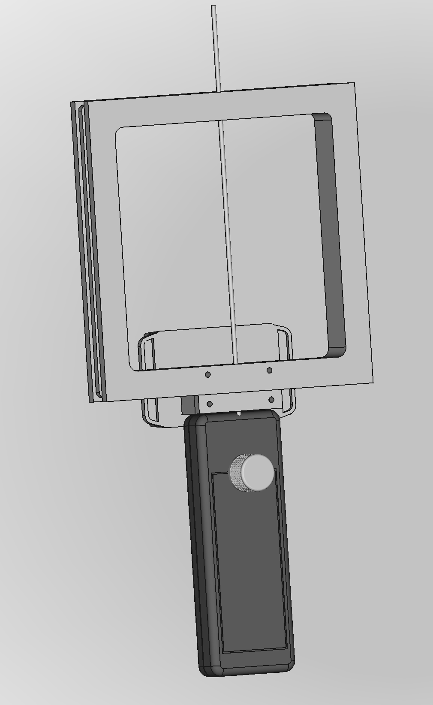

# SignalSnagger
<b>Project Status</b>

SignalSnagger is still in development. Product design and BOM contents are preliminary and incomplete.

<b>Concept</b>

SignalSnagger is an 80-meter band radio orienteering (ARDF) direction-finding receiver designed to operate in the Amateur Radio Service 3.5 MHz to 3.7 MHz frequency range. The receiver is designed to perform well in all common radio orienteering event formats: classic, sprint, and foxoring. SignalSnagger's frequency is stable and accurate using a precision temperature-compensated signal generator. A tuned loop with a "sense antenna," based on Dale Hunt's WB6BYU proven design, provides reliable signal-direction readings over a wide range of signal levels. This is an affordable, modern, competition-grade receiver design.

<b>Mechanical Design</b>

The mechanical design is optimized for simplicity, ruggedness, and ergonomic comfort. Left/right symmetry makes the receiver equally usable for left and right handers. Only the front knob (attached to a rotary encoder) extends beyond the walls of the chassis box, helping to minimize the risk of damage during transport or if dropped. Aside from the wires running to the battery, there is no point-to-point wiring - all connections are handled by PCB traces and parts mounted to the circuit board, eliminating unreliable point-to-point wiring. The headphone jack is on the bottom of the receiver, preventing water intrusion. The square antenna geometry makes for a stronger loop that can be readily fabricated using 3D printing. Switches for sense and configuration are recessed and immune to water penetration. The battery can be charged or replaced without opening the receiver chassis. If something breaks or wears out, all parts are readily available from online vendors, and the schematic diagram and BOM are provided, facilitating customer troubleshooting and repair.

<b>Electronics Design</b>

The electronics design is optimized to avoid part obsolescence and to provide high performance. SignalSnagger uses a Software Defined Radio design, utilizing a quadrature sampling detector to provide high dynamic range and to maximize software-upgradable features. A 25-MHz processor capable of sampling the baseband signal can filter and process the audio to achieve reliable signal strength indication and signal detection and supports DSP algorithms to achieve unparalleled SNR performance to detect weak signals deep in the noise.

<b>Free and Open Design</b>

The SignalSnagger project is 100% Open Source. All software and hardware design documents can be downloaded from this GitHub repository.

BOM: https://docs.google.com/spreadsheets/d/1Z3T1SeX6hfT8fjVtJgXu2S2YWHPFD_kywdSzAihOS8g/edit?usp=sharing

Also, check out SignalSnagger's sibling transmitter project: <a href="https://github.com/OpenARDF/SignalSlinger">SignalSlinger</a>.

## Firmware development

Firmware source lives in
[`Software/AVR128DA48/SignalSnagger`](Software/AVR128DA48/SignalSnagger).
Development and release work follows the same core OpenARDF policy used by
SignalSlinger, adapted for SignalSnagger's single AVR128DA48 target:

- [Codex workflow](CODEX_WORKFLOW.md)
- [Build environment](BUILD_ENVIRONMENT.md)
- [Firmware safety invariants](FIRMWARE_SAFETY.md)
- [Release workflow](RELEASE_WORKFLOW.md)

Start repository work with `just --list`. Use `just check` for the complete
local change gate and `just release-preflight` for deterministic
release-candidate and package verification. `just release-package` creates the
single-target GitHub deliverables: a standalone AVR128DA48 firmware HEX and a
matching release ZIP with metadata, checksums, and programming guidance. The
Si5351 quadrature strategy is experimentally established and must not be
changed without focused regression tests and representative hardware
measurements.

Firmware and software topics integrate through `Development1`; KiCad and
receiver-simulation topics integrate separately through `Development1-KiCad`.
Each collector is promoted to `main` with its own cumulative pull request. Use
`just branch-route-check <collector>` before topic work and `just
collector-preflight <collector>` before promotion. `main` remains linear;
collector pull requests use merge commits so topic and synchronized `main`
ancestry are preserved. After a promotion, use `just collector-sync-check
<collector>` on each focused synchronization topic before merging it.

Every GitHub release follows the mandatory ordered process in
[RELEASE_WORKFLOW.md](RELEASE_WORKFLOW.md), including a reviewed release commit,
clean deterministic packaging, an immutable annotated tag, exact two-asset
publication, fresh-download verification, and checked post-tag evidence.
